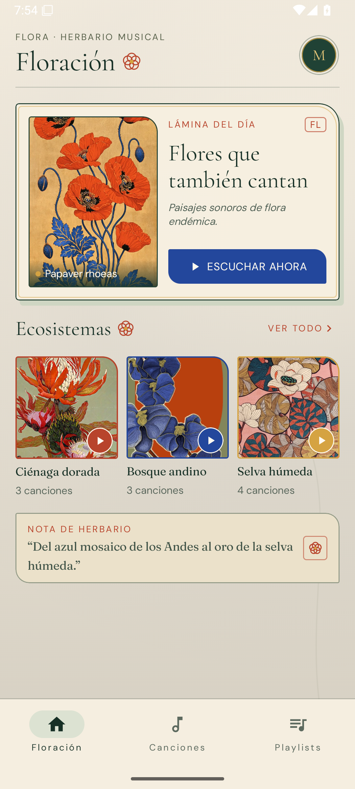
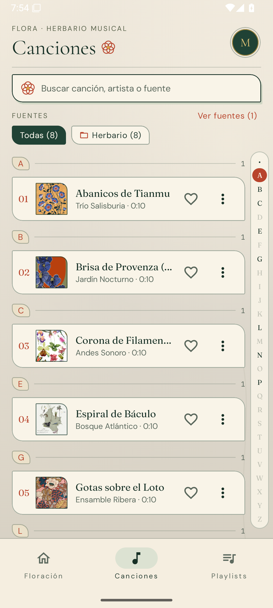
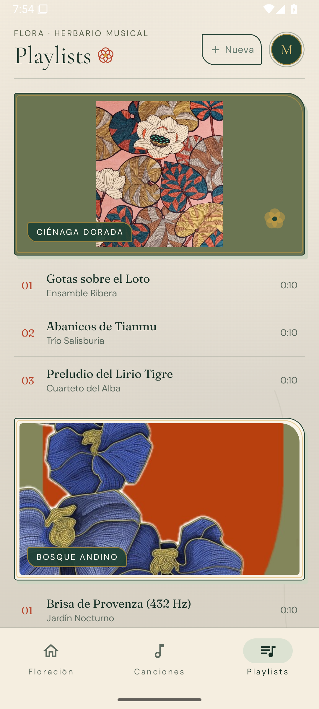
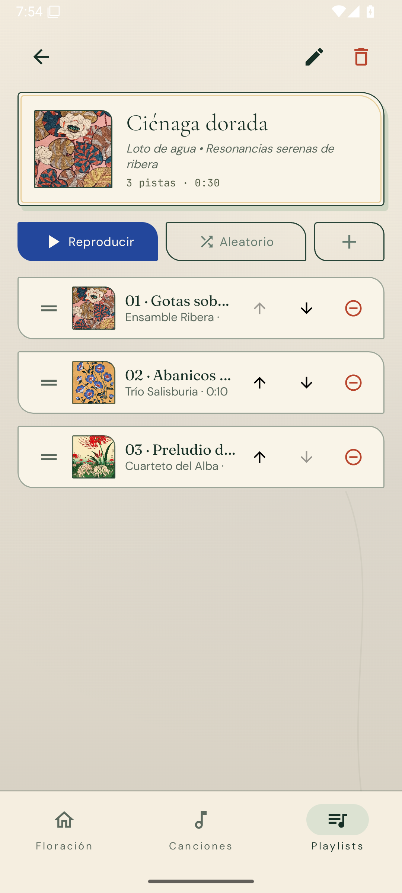
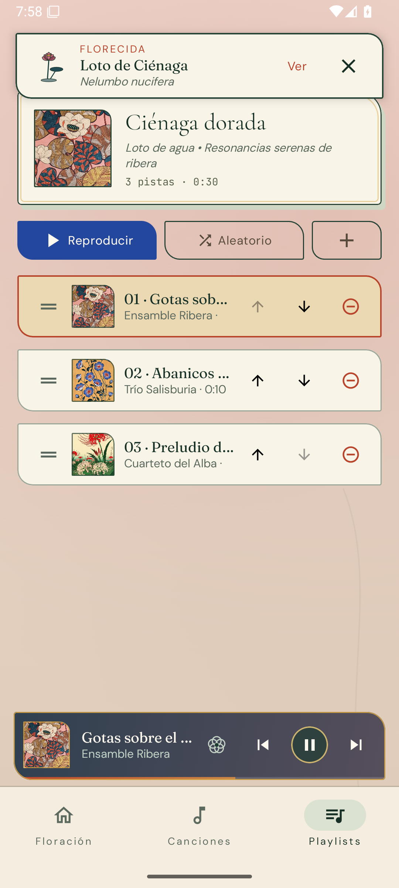
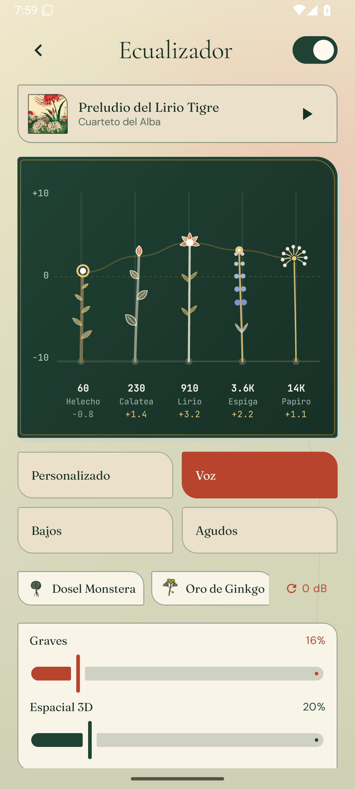

# Flora — Reproductor Musical Botánico (v1.0)

**Flora** es un reproductor de música local y sin conexión para Android con estética de herbario ilustrado, diseñado para escuchar tu fonoteca con reproducción continua, ecualizador orgánico, paletas reactivas y colección botánica desbloqueable.

- **Versión:** `1.0` (`versionCode 1`)
- **Identificador:** `com.aistudio.herbariumplayer.bvnqtx`
- **Compatibilidad:** Android 7.0+ (`minSdk 24`, `targetSdk 36`, `compileSdk 36.1`)
- **Modo de operación:** 100 % local y sin conexión (sin cuentas ni servicios en la nube)

---

## Capturas

| Floración (Inicio) | Canciones (Índice A–Z) | Playlists |
| :---: | :---: | :---: |
|  |  |  |

| Detalle de Playlist | Mini-reproductor y desbloqueo | Ecualizador botánico |
| :---: | :---: | :---: |
|  |  |  |

---

## Principales características

### 1. Reproducción continua y transiciones suaves
- **Motor Media3 / ExoPlayer** con servicio multimedia en primer plano (`mediaPlayback`) y comandos de sesión dedicados (`SessionCommand`) para controlar reproducción y efectos de audio de forma desacoplada.
- **Gapless y Crossfade**: reproducción sin cortes entre pistas y fundido cruzado progresivo entre canciones.
- **Cola de reproducción flexible**: agrega canciones al final o con *Reproducir siguiente*, reordena temas y ajusta la velocidad de reproducción o el **temporizador de reposo**.

### 2. Visualizador orgánico y transición botánica
- Analiza en tiempo real las frecuencias del audio (graves, medios y agudos) mediante FFT optimizada con tablas precalculadas.
- Dibuja formas botánicas animadas (hojas y pétalos) que laten y crecen al ritmo de la música, difiriendo las lecturas de animación a la fase de dibujo para mantener fluidez en pantalla.
- Durante el *crossfade* entre canciones, los elementos visuales florecen y se disuelven acompañando el cambio de carátula.

### 3. Ecualizador visual de tallos
- **5 bandas de frecuencia** representadas como tallos de distintas especies de plantas: su altura e intensidad de balanceo reflejan el nivel de cada banda.
- Incluye **perfiles preestablecidos** (como acústico cálido, bosque o resonancia), control de **graves (Bass Boost)** y efecto envolvente (**Virtualizer**).

### 4. Colores dinámicos, temas y letras
- Extrae automáticamente los colores de la carátula de cada canción para adaptar los degradados de fondo de la interfaz y del reproductor (*modo camaleón*), además de soportar tema **Claro, Oscuro o Sistema** desde Ajustes.
- Permite elegir entre distintas láminas botánicas en *Ahora suena*, editar metadatos y carátulas personalizadas mediante Android Photo Picker, e importar o editar **letras sincronizadas (`.lrc`)**.

### 5. Biblioteca automática y búsqueda rápida
- **Detección automática de fonoteca**: explora carpetas accesibles y seleccionadas por SAF buscando archivos de audio superiores al umbral configurable (90 s por defecto) y los clasifica en **Botanical Library** sin duplicar pistas.
- **Pestaña Canciones**: vista ordenada por título, artista, álbum, duración o reproducciones, con buscador instantáneo, filtros por género/fuente (`FUENTES`) e **índice vertical A–Z** táctil.

### 6. Playlists, respaldo y Herbario interactivo
- **Pestaña Playlists**: crea, edita, duplica, reordena, exporta e importa listas de reproducción en formatos **M3U** y **JSON**.
- **Herbario botánico**: al escuchar distintos géneros, marcar favoritos, curar listas o ajustar el ecualizador, desbloqueas fichas ilustradas y métricas de escucha por especie.
- **Respaldo selectivo**: incluye base de datos Room y preferencias DataStore en copias de seguridad, excluyendo cachés regenerables de audio y portadas.

---

## Estructura de navegación

- **Floración**: pantalla de inicio con la lámina destacada del día, ecosistemas musicales, acceso al herbario y ajustes.
- **Canciones**: catálogo alfabético completo, buscador, pestañas de biblioteca, filtros por carpeta fuente e índice vertical rápido.
- **Playlists**: gestión dedicada de colecciones y listas personalizadas (incluida **Botanical Library**), con importación/exportación M3U y JSON.
- **Reproductor (Ahora suena)**: carátula interactiva, visualizador botánico, vista de **Música / Letras**, cola de reproducción y acceso directo al ecualizador.
- **Ajustes**: configuración de apariencia, umbral de escaneo, fuentes locales y liberación de caché de carátulas.

---

## Notas de la primera build (`v1.0`)

- **Optimización de compilación (Release):** minificación con **R8** y reducción de recursos (`isMinifyEnabled = true`, `isShrinkResources = true`) con reglas específicas para KotlinX Serialization, Room, DataStore y Media3 `Bundleable`.
- **Memoria y almacenamiento:** caché LRU de carátulas en `RGB_565` para portadas opacas, reescalado automático al importar portadas personalizadas o incrustadas (identificadas mediante hash SHA-256) y carga directa de recursos locales para las pistas semilla sin duplicar archivos en disco.
- **Permisos declarados:** `READ_MEDIA_AUDIO` (Android 13+), `READ_EXTERNAL_STORAGE` (`maxSdkVersion="32"`), `FOREGROUND_SERVICE`, `FOREGROUND_SERVICE_MEDIA_PLAYBACK`, `POST_NOTIFICATIONS` y `WAKE_LOCK`.

---

## Descarga y compilación

### Instalación
Puedes descargar el APK oficial firmado y verificar su suma SHA-256 desde la sección **Releases** del repositorio.

### Compilación y pruebas locales
```bash
# Compilar APK de depuración
gradle assembleDebug

# Ejecutar pruebas unitarias locales
gradle :app:testDebugUnitTest
```

---

## Tecnologías del proyecto

- **Lenguaje y UI**: Kotlin, Jetpack Compose, Material Design 3 (diseño adaptativo para teléfono y tablet).
- **Audio**: AndroidX Media3 (ExoPlayer + MediaSession), efectos de audio nativos y procesadores PCM para análisis FFT y *crossfade*.
- **Color e imagen**: AndroidX Palette para extracción dinámica de colores y decodificación muestreada.
- **Persistencia**: Room (biblioteca, canciones y playlists) y DataStore Preferences (ecualización, tema y sesión de reproducción).
