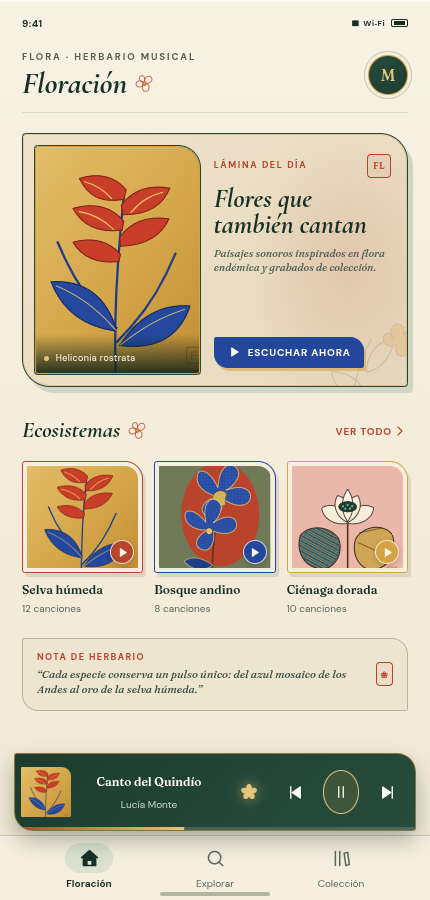
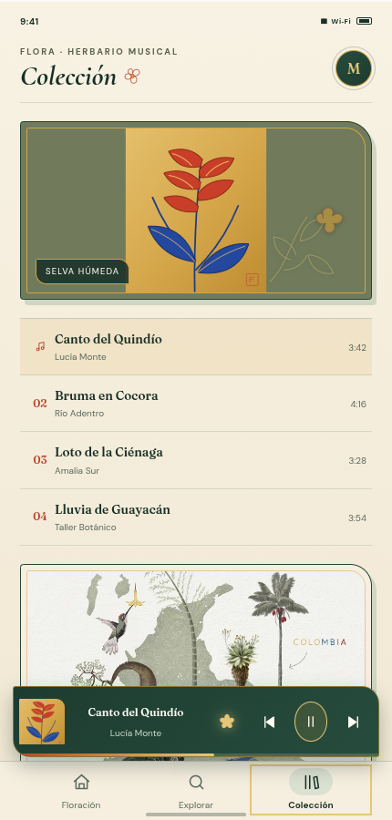
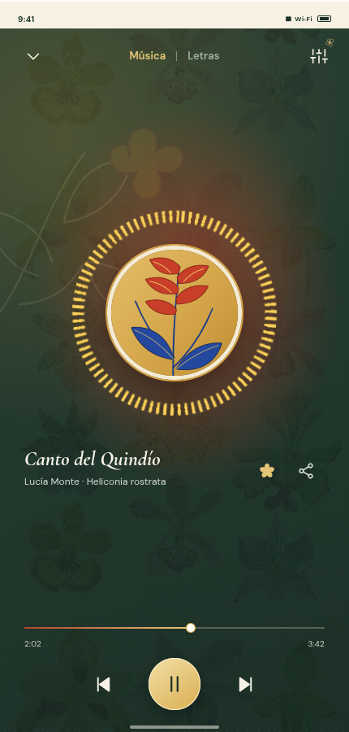
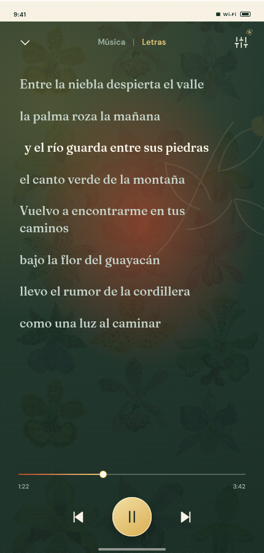
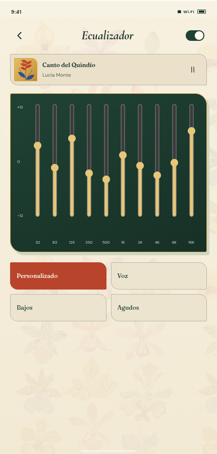
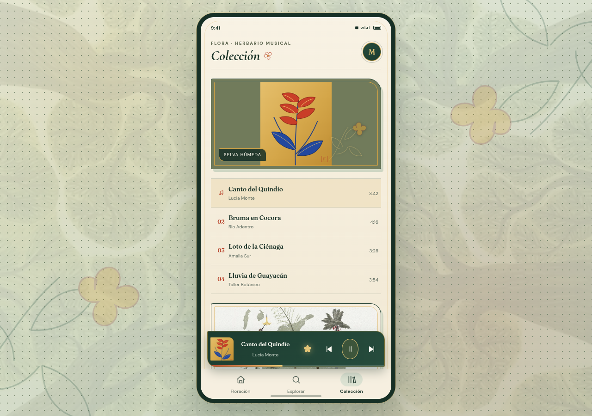

# Flora — Reproductor Musical Botánico

**Flora** es un reproductor de música para Android con estética de herbario ilustrado, pensado para escuchar tu biblioteca local con una experiencia visual viva, fluida y sin distracciones.

---

## Capturas

| Floración (Inicio) | Colección y Playlists | Reproductor (Música) |
| :---: | :---: | :---: |
|  |  |  |

| Reproductor (Letras) | Ecualizador | Presentación general |
| :---: | :---: | :---: |
|  |  |  |

---

## Principales características

### 1. Reproducción continua y transiciones suaves
- **Motor Media3 / ExoPlayer** con servicio en segundo plano para seguir escuchando con la pantalla apagada o desde la notificación del sistema.
- **Gapless y Crossfade**: reproducción sin cortes entre pistas y fundido cruzado progresivo entre canciones.
- **Cola de reproducción flexible**: agrega canciones al final o con *Reproducir siguiente*, reordena temas y ajusta la velocidad de reproducción o el **temporizador de reposo**.

### 2. Visualizador orgánico y transición botánica
- Analiza en tiempo real las frecuencias del audio (graves, medios y agudos).
- Dibuja formas botánicas animadas (hojas y pétalos) que laten y crecen al ritmo de la música.
- Durante el *crossfade* entre canciones, los elementos visuales florecen y se disuelven acompañando el cambio de carátula.

### 3. Ecualizador visual de tallos
- **5 bandas de frecuencia** representadas como tallos de distintas especies de plantas: su altura e intensidad de balanceo reflejan el nivel de cada banda.
- Incluye **perfiles preestablecidos** (como acústico cálido, bosque o resonancia), control de **graves (Bass Boost)** y efecto envolvente (**Virtualizer**).

### 4. Colores dinámicos y temas del reproductor
- Extrae automáticamente los colores de la carátula de cada canción para adaptar los degradados de fondo de la interfaz y del reproductor (*modo camaleón*).
- Permite elegir entre distintas láminas y temas botánicos ilustrados para personalizar la pantalla *Ahora suena*.

### 5. Biblioteca automática y búsqueda rápida
- **Detección automática en segundo plano**: busca carpetas accesibles con archivos de audio mayores a **90 segundos** y los clasifica automáticamente en la colección **Botanical Library** sin duplicar canciones.
- **Pestaña Canciones**: lista ordenada alfabéticamente con buscador por título, artista o carpeta fuente (`FUENTES`).
- **Índice vertical A–Z**: barra lateral derecha al estilo de los reproductores modernos; permite tocar o deslizar el dedo para saltar al instante a cualquier letra con indicador flotante.

### 6. Playlists y Herbario interactivo
- **Pestaña Playlists**: crea, edita, elimina y reordena las canciones de tus listas de reproducción de forma independiente.
- **Herbario botánico**: al reproducir distintos géneros, marcar favoritos, crear listas o ajustar el ecualizador, desbloqueas fichas ilustradas de especies botánicas.

---

## Estructura de navegación

- **Floración**: pantalla de inicio con la lámina destacada del día, ecosistemas musicales y acceso rápido a tus listas.
- **Canciones**: catálogo alfabético completo, buscador, filtros por carpeta fuente e índice vertical rápido.
- **Playlists**: gestión dedicada de colecciones y listas personalizadas (incluida **Botanical Library**).
- **Reproductor (Ahora suena)**: carátula interactiva, visualizador botánico, vista de **Música / Letras**, cola de reproducción y acceso directo al ecualizador.

---

## Tecnologías del proyecto

- **Lenguaje y UI**: Kotlin, Jetpack Compose, Material Design 3 (diseño adaptativo para teléfono y tablet).
- **Audio**: AndroidX Media3 (ExoPlayer + MediaSession), efectos de audio nativos y procesador PCM para análisis de espectro y *crossfade*.
- **Color e imagen**: AndroidX Palette para extracción dinámica de colores.
- **Persistencia**: Room (biblioteca, canciones y playlists) y DataStore (preferencias de ecualización y tema).
- **Compatibilidad**: Android 7.0+ (`minSdk 24`, `targetSdk 36`).
